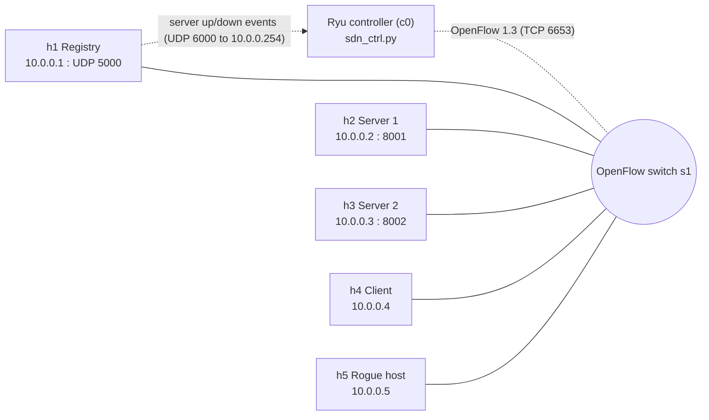
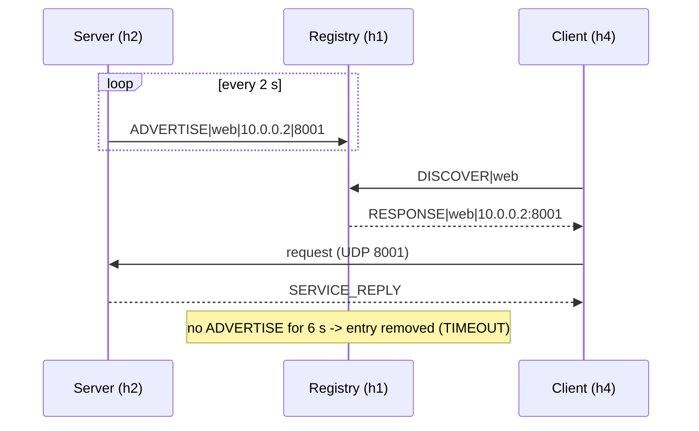

# Architecture: UDP Service Discovery System with SDN

## 1. Objective
Build a UDP-based service discovery system in which servers advertise
services, a registry keeps track of them, and clients discover them. The
network is emulated in Mininet and controlled by a Ryu OpenFlow 1.3 SDN
controller that prioritises discovery traffic and blocks unauthorised hosts.

### Requirements and where each is implemented
| Requirement | Implementation |
|---|---|
| UDP service advertisements | `src/server.py` sends `ADVERTISE` every 2 s |
| Service registry | `src/registry.py` table `{service: {(ip, port): last_seen}}` |
| Discover services | `src/client.py` sends `DISCOVER`, registry answers `RESPONSE` |
| Service timeouts | Registry purges entries not refreshed within 6 s; client uses 1 s timeout and 3 retries |
| Detect unavailable servers | Missing advertisements -> `TIMEOUT` event, server removed from replies |
| SDN controls service traffic | `controller/sdn_ctrl.py`: priority flows, allow-list, blocking, monitoring |
| Dynamic registration | Servers join/leave at runtime (`ADVERTISE` / `DEREGISTER`), no restarts |
| Discovery latency | `src/client.py` measures round trip with `time.perf_counter()`, CSV output |

## 2. System architecture

## 3. Components
| Component | File | Role |
|---|---|---|
| Registry | `src/registry.py` | Listens on UDP 5000, stores live services, answers discovery queries, purges expired entries |
| Server | `src/server.py` | Advertises itself every 2 s, serves requests on its own UDP port, deregisters on exit |
| Client | `src/client.py` | Queries the registry, retries on timeout, measures latency, can call the discovered service |
| Controller | `controller/sdn_ctrl.py` | Learning switch, discovery-traffic flows, rogue-host blocking, flow-stats monitoring |
| Topology | `topology/topo.py` | One switch, five hosts, remote controller; the VM root namespace is attached as 10.0.0.254 so the registry can reach the controller |

## 4. Application protocol (UDP, text, `|` separated)
| Message | Direction | Example |
|---|---|---|
| `ADVERTISE\|service\|ip\|port` | server -> registry | `ADVERTISE\|web\|10.0.0.2\|8001` |
| `DEREGISTER\|service\|ip\|port` | server -> registry | `DEREGISTER\|web\|10.0.0.2\|8001` |
| `DISCOVER\|service` | client -> registry | `DISCOVER\|web` |
| `RESPONSE\|service\|ip:port,...` | registry -> client | `RESPONSE\|web\|10.0.0.2:8001,10.0.0.3:8002` |

Registry -> controller events (UDP, sent to 10.0.0.254:6000):

| Message | Meaning |
|---|---|
| `EVENT\|SERVER_UP\|service\|ip\|port\|new` | server registered for the first time |
| `EVENT\|SERVER_DOWN\|service\|ip\|port\|timeout` | advertisements stopped for 6 s |
| `EVENT\|SERVER_DOWN\|service\|ip\|port\|deregister` | server left gracefully |

The controller accepts events only from the registry (10.0.0.1).

Timing: advertisement interval 2 s; registry TTL 6 s (3 missed
advertisements); client timeout 1 s with up to 3 attempts.

## 5. Message flow

## 6. SDN behaviour (OpenFlow 1.3 flow table)
| Priority | Match | Action | Purpose |
|---|---|---|---|
| 100 | UDP, dst port 5000, src IP in allow-list | NORMAL | Allowed discovery traffic |
| 100 | UDP, src port 5000 | NORMAL | Registry replies |
| 96 | UDP, dst IP:port of a server reported down | drop | Installed on `SERVER_DOWN`, removed on `SERVER_UP` |
| 95 | UDP, dst port 5000, src IP = blocked host | drop | Installed dynamically per rogue host |
| 90 | UDP, dst port 5000 (anyone else) | send to controller | Controller logs and blocks unknown hosts |
| 1 | in_port, eth_src, eth_dst | output port | Learned forwarding |
| 0 | any | send to controller | Table miss |

Flow: an unknown host sending to port 5000 matches priority 90, so the
packet goes to the controller. The controller logs `BLOCKED` and installs a
priority-95 drop rule, after which the switch drops that host's discovery
traffic without involving the controller. The controller polls flow statistics
every 5 s and logs request, reply and blocked-packet counts.

## 7. Implemented and planned extensions
- Implemented: registry notifies the controller of server up/down events; the controller drops traffic to dead servers and restores it on recovery
- Redundant topology with link-failure rerouting
- Congestion and performance experiments against a plain learning-switch baseline

## 8. How to run
1. Controller: `source venv/bin/activate && ryu-manager controller/sdn_ctrl.py`
2. Topology: `sudo mn -c && sudo python3 topology/topo.py`
3. In the Mininet CLI:
   - `h1 python3 src/registry.py > results/registry.log 2>&1 &`
   - `h2 python3 src/server.py --name web --port 8001 > results/s1.log 2>&1 &`
   - `h3 python3 src/server.py --name web --port 8002 > results/s2.log 2>&1 &`
   - `h4 python3 src/client.py --service web --count 5 --use`
